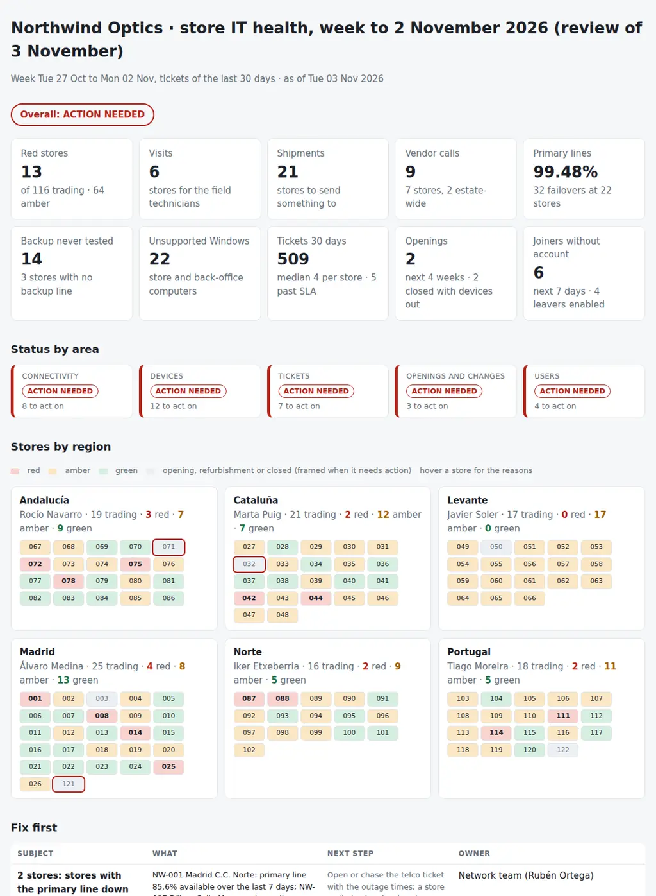

# Retail Store IT Health Review

The weekly review of a retail chain's store IT, run by central IT for stores with no IT staff on site: can each store sell and operate tomorrow, and which stores need a visit, a shipment or a vendor call? From the store list, the daily connectivity per store from the monitoring tool, the Intune and Active Directory devices, the printer status, the store tickets, the opening and closing checklists and the joiners and leavers, it puts together:

- **Connectivity:** primary line availability over the last week, failovers to the 4G/LTE backup router and time on backup, backup routers never tested and backup SIMs near their data cap, stores with no backup line, the site-to-site tunnel to head office by store and by region (a region whose tunnels all drop at the same hour), and failed AnyConnect connections from the back-office laptops.
- **Devices:** store PCs and back-office computers not checked in or on a Windows version out of support, printers (receipt, label and A4) offline or low on toner, receipt printers that jam again and again and the model behind them, card terminals not reporting, stock handhelds offline, and UPS that failed their self-test or carry an old battery.
- **Tickets:** tickets per store in the last 30 days against the estate median, repeat incidents, tickets open past SLA, field visits pending and vendor tickets open (telco, printer vendor, payment provider).
- **Openings and changes:** the pre-opening checklist of every store opening in the next four weeks (line ordered and installed, backup router, printers, terminals, staff accounts, test day), closed stores with devices not recovered, closings and refurbishments.
- **Users:** new store staff starting in the next days without an account, leavers still enabled and shared store accounts of closed stores.

Nine CSVs, one JSON with the thresholds and one Python command give every store a status (**red**, **amber** or **green**) with its reasons, each area a status (**on track**, **attention** or **action needed**), an overall verdict, a store grid by region, a ranked **visit and ship list by region and field technician**, the vendor calls, and the pack for the weekly retail operations meeting: **which stores are red and why, who goes where, what gets shipped, which vendors to chase, and what opens next.**

Python 3.10+, standard library only. It runs with fictional demo data out of the box. A read-only PowerShell exporter for Microsoft Graph, Active Directory and Entra ID is included.



## Why

Central IT sees a hundred stores through a monitoring console, a device list and a ticket queue, each in its own tool. In a typical week:

- a shopping centre store fails over to its 4G router nine times, keeps selling, and nobody notices that its SIM is at 93% of its data cap until the router is throttled on Saturday afternoon;
- fourteen backup routers have never been tested, so nobody knows whether they would work;
- every store in one region loses its tunnel to head office around eight in the evening, and the service desk logs it as seventeen separate problems;
- a corner inside a department store opens in ten days and its line is still not installed, because the carrier cannot get past the department store's comms room;
- three stores with the same receipt printer model log jam after jam, and each one gets a new roll of paper and a ticket closed;
- one store raises four times the median number of tickets, almost all about the handhelds losing Wi-Fi in the stockroom;
- twenty-two back-office PCs are still on Windows 10, a UPS failed its self-test, and two card terminals stopped reporting on Sunday;
- two stores closed weeks ago with their laptops, terminals and handhelds still inside;
- and two people start tomorrow in stores where nobody has created their account.

The monitoring tool knows the lines and the printers, Intune and Active Directory know the computers, the ITSM tool knows what broke and who is waiting for a vendor, the openings tracker knows what is due, and HR knows who starts and who leaves. The weekly review that matters joins them by store. The rules are in `settings.json` and `storehealth/checks.py`.

## What it checks

| Area | Code | Finding |
|---|---|---|
| Connectivity | CON-01 | Primary line availability over the week under `uptime_warning` (critical under `uptime_critical`), or the line down on the last day, with how many days |
| Connectivity | CON-02 | Failovers to the backup router or minutes on backup over `failover_warning` / `backup_minutes_warning` (critical over the `_critical` values) |
| Connectivity | CON-03 | Backup router never tested, or last tested more than `backup_test_max_days` ago |
| Connectivity | CON-04 | Backup SIM at `data_cap_warning` of its data cap (critical at `data_cap_critical`) |
| Connectivity | CON-05 | Stores with no backup line (critical when the primary line is also failing) |
| Connectivity | CON-06, CON-07 | Site-to-site tunnel dropping on `tunnel_flap_days` days of the week; a region where `region_flap_share` of the stores flap, critical when the drops fall inside trading hours |
| Connectivity | CON-08 | Failed AnyConnect connections from the store's laptops over `anyconnect_warning` |
| Devices | DEV-01, DEV-02 | Store and back-office computers not checked in for `stale_days` (a visit after `stale_visit_days`); on a Windows build out of support or within 30 days of its end of servicing |
| Devices | DEV-03, DEV-04 | Printers offline for `printer_offline_hours` (critical for receipt printers, ship a swap after `printer_ship_hours`); toner under `toner_warning` (critical under `toner_critical`) |
| Devices | DEV-05, DEV-06 | A receipt printer with `jam_repeat` jam tickets in the window; one model jamming in `jam_model_stores` stores (vendor call) |
| Devices | DEV-07, DEV-08 | Card terminals not reported for `terminal_stale_hours`; stock handhelds offline for `handheld_stale_days` |
| Devices | DEV-09 | UPS self-test failed (critical) or a battery older than `ups_battery_years` |
| Tickets | TKT-01, TKT-02 | Tickets per store at `ticket_ratio_warning` times the estate median (critical at `ticket_ratio_critical`); the same category `repeat_count` times |
| Tickets | TKT-03 | Open past the SLA of its priority (`sla_hours`; critical for P1/P2; on hold does not count) |
| Tickets | TKT-04, TKT-05 | Field visits pending; vendor tickets open more than `vendor_open_days` (critical for the telco when the store's line is down or failing over) |
| Openings and changes | OPN-01 | Openings within `opening_weeks`: the line not installed within `opening_critical_days` (critical), overdue or blocked items |
| Openings and changes | OPN-02, OPN-03 | Closed stores with devices not recovered (critical), closings and their overdue items; refurbishments |
| Users | USR-01, USR-02, USR-03 | Joiners within `joiner_days` without an enabled account (critical when they start tomorrow); leavers still enabled; shared accounts of closed stores |

## Outputs

| File | What |
|---|---|
| `report.html` | Overall verdict, tiles, status by area, the store grid by region with red, amber and green (hover a store for its reasons), "Fix first", the visit and ship list by region and technician, one section per area, the trend against last week and all findings |
| `store-review.md` | The pack for the weekly retail operations meeting: headlines, red stores and why, the status by region, visits and shipments by technician, vendor calls, openings in the next four weeks with closings and refurbishments, connectivity, devices, tickets, users, the trend against last week (and new red stores), findings, actions and sign-off |
| `stores.csv` | Every store with its status and last week's, its numbers (line, failovers, backup test, data cap, tunnel, tickets) and its issues; next week's `previous-stores.csv` |
| `connectivity.csv` | Each store's week against the previous one: availability, failovers, minutes on backup, backup test, data cap, tunnel drops and their peak hour, AnyConnect |
| `devices-review.csv` | Every computer, handheld, terminal, UPS and printer with its last contact, OS and end of servicing, health or toner, jam tickets and the action |
| `tickets-review.csv` | The tickets of the window and every open one, with age, SLA, SLA paused, field visit and vendor |
| `openings.csv` | Every checklist item of the openings, closings and refurbishments, with the days to go and what is overdue |
| `visits.csv` | The visit, ship and vendor list: region, technician, rank, store, what to do and why |
| `actions.csv`, `findings.csv` | The findings with owner and next step, ready for a tracker |

## Try it

```bash
git clone https://github.com/inigogonzalezgarcia/42-retail-store-it-health.git
cd 42-retail-store-it-health
python -m storehealth demo
```

Open `output/report.html` and `output/store-review.md`.

### The demo data

The demo is a made-up eyewear chain, Northwind Optics, reviewed on Tuesday 3 November 2026:

- 122 stores in six regions of Spain and Portugal (Madrid, Cataluña, Levante, Andalucía, Norte and Portugal), each with its field technician: street stores, shopping centre stores and corners inside a fictional department store, Galerías Adatum; 116 trading, two opening, two in refurbishment and two closed;
- two weeks of daily connectivity per store, 806 devices (store PCs, back-office PCs and laptops, Zebra handhelds, card terminals and UPS) and 337 printers;
- 510 store tickets, the opening and closing checklists, the joiners and leavers, the store accounts, and last week's status of every store.

Everything is fictional, and the faults attributed to printer models are made up. The problems are placed on purpose among the everyday ones:

- **Lines:** a shopping centre store in Madrid that failed over to 4G nine times in a week, 1,450 minutes on backup, its SIM at 93% of the cap and a telco ticket open for six days; a street store in Bilbao on its backup for three days; 14 backup routers never tested and 3 tested months ago; 3 stores with no backup line.
- **Tunnels:** all 17 trading stores in Levante losing the site-to-site tunnel around 20:00, inside trading hours, almost every evening since 25 October.
- **Opening:** a corner inside Galerías Adatum opening on Friday 13 November whose line is blocked because the carrier cannot reach the corner until the department store patches its floor comms room; its four staff start on 10 November with no accounts.
- **Printers:** three stores whose Epson TM-T20III receipt printers jam repeatedly (13 tickets), a receipt printer offline since yesterday, a label printer offline for three days and seven printers low on toner.
- **Devices:** 22 back-office PCs on Windows 10 22H2, 5 store PCs on Windows 11 23H2 a week before its end of servicing, a UPS that failed its self-test, 5 old UPS batteries, two card terminals silent since Sunday, four handhelds offline.
- **Tickets:** a store in Sevilla with 18 tickets in 30 days, 4.5 times the median, 13 of them the handhelds dropping Wi-Fi in the stockroom; tickets past SLA, field visits pending and vendor tickets open.
- **Changes and users:** two closed stores with seven devices each still inside and their shared accounts enabled, a store closing on 21 November whose line cancellation is overdue, two people starting tomorrow without an account, four leavers still enabled.

## Use it with your own data

1. Export (read-only):
   ```powershell
   .\scripts\Export-StoreHealthData.ps1 -OutputFolder .\data -IncludeUsers -UserLike '*@yourdomain' -ADSearchBase 'OU=Stores,DC=corp,DC=local'
   ```
   - Microsoft Graph PowerShell with read-only scopes: `DeviceManagementManagedDevices.Read.All` (`Get-MgDeviceManagementManagedDevice`) and, with `-IncludeUsers`, `User.Read.All` (`Get-MgUser`, with `employeeId`, `accountEnabled` and `officeLocation`).
   - Active Directory, optional (`-ADSearchBase`, RSAT): `Get-ADComputer` with `OperatingSystem`, `OperatingSystemVersion` and `LastLogonDate` for domain-joined store computers.
   - The store id comes from the device name (`-StorePattern`) and the role from its suffix (`-RoleBySuffix`).
2. Add the files that live in other tools: `stores.csv` (your store list), `connectivity.csv` and `printers.csv` (exports of your network monitoring tool; the printer status and toner come from the standard SNMP printer objects), the card terminal and UPS rows of `devices.csv` (payment provider portal, UPS network cards), `tickets.csv` (ServiceNow or Jira export), `openings.csv` (your openings tracker) and `staff.csv` (HR joiners and leavers). Copy last week's `output/stores.csv` as `previous-stores.csv` for the trend.
3. Adjust `data/settings.json`: thresholds, SLA hours by priority, the shared account pattern and the owners ([docs/data-format.md](docs/data-format.md) has every column and setting).
4. Build the outputs:
   ```bash
   python -m storehealth review data/ --title "Store IT health · week 45"
   ```

[docs/store-health-runbook.md](docs/store-health-runbook.md) has the weekly cycle, the agenda of the retail operations meeting and how to read each signal.

The exports contain device names, people's names and accounts. Keep them inside your organisation:

- real files at the top level (`stores*.csv`, `connectivity*.csv`, `devices*.csv`, `printers*.csv`, `tickets*.csv`, `openings*.csv`, `staff*.csv`, `users*.csv`, `previous-stores*.csv`, `settings.json`, `data/`) and the `output/` folder are excluded from Git by `.gitignore`;
- only the fictional files in `sample_data/` are committed.

## Tests

```bash
pip install -r requirements-dev.txt
python -m pytest -q
```

GitHub Actions runs them on Python 3.10 and 3.12 on every push, then rebuilds the fictional sample data and the report screenshot from the simulator.

14 tests: the store list with the status from the dates, connectivity, Intune and Active Directory devices, SNMP printers, tickets and Entra ID accounts; lines down and failing over, data caps and stores with no backup; backup tests and a region whose tunnels drop in trading hours; computers, Windows end of servicing, terminals, handhelds and UPS; printers offline, toner and a jamming model; ticket volume against the median, repeats, SLA with on hold, field visits and vendors; an opening with its line blocked, a closed store with devices inside and a refurbishment; joiners, leavers and shared accounts; settings overrides; store status, the visit list and the trend against last week; status by area and overall; the pack and the CSVs; missing files; and the demo end to end (deterministic, all ten outputs).

## Next steps

- Run the exports and the review every Monday night and send each field technician their part of the visit list.
- Read the ticket export from the ServiceNow Table API instead of a list export.
- Keep a history of the weekly `stores.csv` to show each store's trend over a quarter.
- Add the store Wi-Fi access points and switches from the monitoring tool as devices of their own.

## Background

Built from my work supporting retail stores and their openings:

- supporting the boutiques and points of sale of luxury retail brands, with their printers, Cisco AnyConnect VPN and user onboarding (network, email, AS400 and business apps);
- about 200 pre-openings of brand corners inside department stores; at one of them the connectivity failed two hours before opening, and I restored service with a temporary USB/4G router while checking the store's connection and the floor's comms room with the department store's technicians;
- Intune and Microsoft Graph for device management and reporting;
- ITSM process owner for incidents and changes;
- supporting about 2,500 users across European offices.

Written from scratch with fictional data; no employer data, systems or exports are used.

## Customisation and contact

Want this adapted to your environment? For example:

- the exports of your network monitoring tool, your ITSM tool or your openings tracker;
- your store formats, regions, field technicians and opening hours;
- your thresholds, SLAs and the devices your stores have;
- the pack in the format of your retail operations meeting.

Get in touch:

- Website (contact form): [inigogonzalezgarcia.github.io](https://inigogonzalezgarcia.github.io/about.html#contacto)
- LinkedIn: [linkedin.com/in/igonzalez93](https://www.linkedin.com/in/igonzalez93)

## License

MIT
